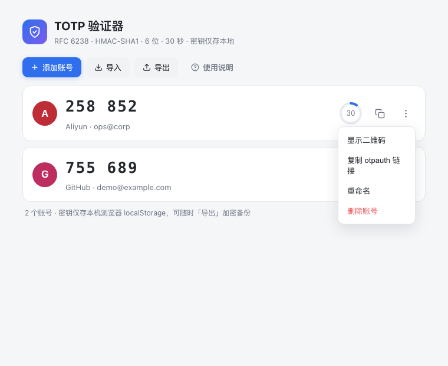

# totp-authenticator · TOTP 验证器

> 纯前端单文件两步验证器——浏览器双击打开即用，密钥只存本机，无后端、无统计、无上报。支持从 Google Authenticator 一键迁移。



一个 HTML 文件就是一个完整的动态口令生成器：SHA-1 / HMAC-SHA1 / Base32 / HOTP / TOTP 全部纯 JS 手写并通过 [RFC 4226](https://datatracker.ietf.org/doc/html/rfc4226) / [RFC 6238](https://datatracker.ietf.org/doc/html/rfc6238) 官方测试向量验证，不依赖任何密码学库。

## 它能做什么

- **动态口令**：RFC 6238 TOTP，6/8 位、30/60s 周期，点击验证码即复制
- **账号管理**：添加 / 重命名 / 删除 / 重名去重，彩色头像 + 倒计时进度环（剩 5 秒变红，提醒等新码）
- **备份迁移**：JSON 导出 / 导入，可选口令加密（PBKDF2 21 万次迭代 + AES-256-GCM）；每个账号可反向生成 otpauth 二维码，供手机验证器扫描
- **Google Authenticator 迁移**：GA「导出账号」的 `otpauth-migration://` 链接直接粘贴导入（原生 DecompressionStream 解压 + 手写 protobuf 解码，无第三方库）
- **时间偏差检测**：TOTP 对时钟敏感，本机时间不准时自动弹横幅提醒校准

## 快速开始

```bash
git clone https://github.com/zhangYIBO1993/totp-authenticator.git
open totp-authenticator.html   # 或直接在浏览器里双击打开
```

无安装、无依赖、无构建。唯一的外部资源是二维码生成库（jsdelivr CDN），离线时自动降级为文本链接，核心功能完全离线可用。

## 使用手册

### 添加账号（三种方式）

| 方式 | 操作 | 适用 |
|---|---|---|
| ① 粘贴链接 | 平台开启两步验证时选择「验证器 App」，复制 `otpauth://` 链接，点「添加账号」粘贴（支持多行批量） | 大多数平台（GitHub / Google / 阿里云等） |
| ② GA 迁移 | Google Authenticator → 设置 → 导出账号，把屏幕上的二维码**截图**，用任意「二维码解码」工具读出 `otpauth-migration://` 链接，粘贴到「添加账号」或「导入」 | 从手机 GA 批量搬家 |
| ③ 手动输入 | 只拿得到密钥字符串时，填账号名 + Base32 密钥 | 纸质恢复码 / 老平台 |

GA 迁移说明：仅支持 TOTP 条目，HOTP 会被跳过并计数提示；条目名带 `平台:账号` 格式会自动切分。

### 日常使用

- 点击验证码即复制（30 秒内输入有效）；进度环变红表示即将刷新，建议等新码再输
- 列表下方常驻一行 `N 个账号 · 密钥仅存本机浏览器 localStorage`，随时确认数据位置
- ⋮ 菜单：显示二维码 / 复制 otpauth 链接 / 重命名 / 删除

### 备份与换设备迁移

1. 旧设备：「导出」→ 输入一个 ≥8 位的备份口令 → 下载加密 JSON（不设口令则为明文 JSON）
2. 新设备：打开本页 → 「导入」→ 选择备份文件（或粘贴内容）→ 输入相同口令
3. 重名账号自动跳过，不会覆盖现有条目

建议定期导出加密备份——这是本工具唯一的数据安全网（见下节）。

### 顶部提示条的含义

| 提示 | 含义 | 处理 |
|---|---|---|
| ⏰ 时间偏差 | 本机时间与标准时间相差 ≥5 秒，验证码可能被服务端拒绝 | 校准系统时间（设置 → 日期与时间 → 自动设置） |
| ⚠ 旧版加密数据 | 此浏览器存过 2026-11 之前的指纹加密版本（v2），当前环境解不开（浏览器升级 / 换设备所致） | 原数据仍保留未删；用此前导出的备份「导入」恢复 |

## 存储与安全模型（诚实声明）

- **密钥只存本机**：保存在浏览器 localStorage（键 `totp-authenticator-store-v3`），不上传任何服务器；无后端、无统计、无账号体系
- **唯一网络请求**：对 baidu.com 的一次 HEAD 请求，仅读取响应头中的标准时间做偏差检测；页面声明 `no-referrer`，不发送任何数据
- **为什么明文存储而不是加密**：早期版本（v2）用「设备指纹派生密钥」对 localStorage 做 AES-GCM 加密，但浏览器升级会改 UA、插拔显示器会改屏幕尺寸——指纹一变密文即解不开，而下一次保存会覆盖旧密文，**密钥永久丢失**。混淆级防护换来真实的数据丢失风险，不值。备份安全交给带口令的加密导出（AES-256-GCM），这才是正确的信任边界
- **边界**：能接触你浏览器数据的人就能读到密钥；不要在公共电脑上使用本工具；定期导出加密备份

## 开发与自检

```bash
node test-totp.mjs   # 16 项无框架自检
```

覆盖：RFC 4226 / 6238 官方测试向量、Base32 编解码往返、otpauth 解析与构造往返、v3 明文存取、v1/v2 旧数据迁移（含解密失败不覆盖原数据）、GA 迁移链接解码（raw-deflate 与 zlib 头两种压缩）。

## 致谢

- [RFC 4226](https://datatracker.ietf.org/doc/html/rfc4226)（HOTP）/ [RFC 6238](https://datatracker.ietf.org/doc/html/rfc6238)（TOTP）
- Google Authenticator 的 `otpauth-migration://` 导出格式（社区逆向文档）
- [qrcode-generator](https://github.com/kazuhikoarase/qrcode-generator)（MIT，二维码生成）

## License

[MIT](LICENSE)
